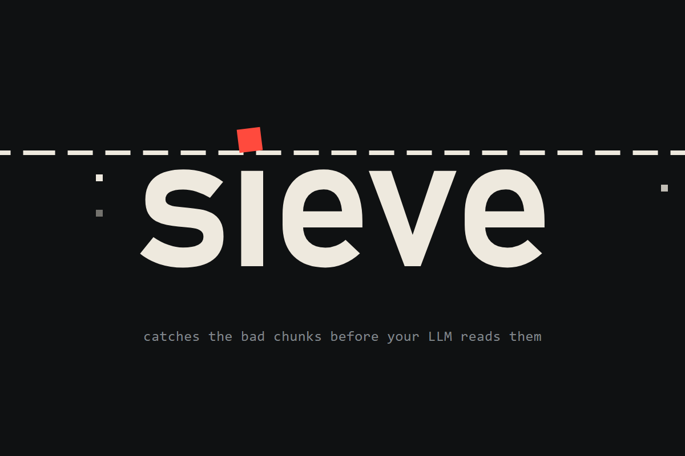

# Sieve



**Catches the bad chunks before your LLM reads them.**

Sieve is a security agent that sits between a RAG retriever and the LLM. It inspects every retrieved chunk before the model sees it and blocks or redacts anything unsafe: prompt injection, aggregation leaks, stale permissions, secrets/PII and poisoned documents.

**Live demo:** https://sieve-cms2.onrender.com · **Video:** https://www.youtube.com/watch?v=6jv9gqlvEyw

## Team

Built together by **Abbas Rahman**, **Humayun Arshad** and **Sunaina Babar** for the Nebius × NVIDIA Global AI Hackathon.

## Nebius Token Factory and NVIDIA Nemotron

Sieve's LLM judges (injection, poisoning and aggregation) call an OpenAI-compatible endpoint, configured for **Nebius Token Factory** by default (`firewall/llm.py`), and are designed to run on an **NVIDIA Nemotron** model chosen via `FIREWALL_MODEL`. Only flagged chunks are escalated, under a per-request budget and a process-wide cap, so a cheap model is enough.

**Current status:** the benchmark numbers and the live demo above run on Sieve's rules alone; the LLM judges are implemented and covered by tests with a stand-in model, but have not yet been run against Token Factory. To enable them, set `NEBIUS_API_KEY` and `FIREWALL_MODEL` in `.env` (see `scripts/list_models.py`) and re-run `python benchmark/run.py`.

## Layout

| Folder | What lives there |
| --- | --- |
| `firewall/` | The agent: checks, LLM judges, policy, baselines |
| `locus_mock/` | Mock RAG workspace API with fictional data for the demo |
| `dataset/` | `build_cases.py` → `cases.json`: 194 attack and benign cases, split dev/test |
| `benchmark/` | `run.py`: runs every setup over the dataset and writes `results.json` |
| `web/` | The demo site (plain HTML/CSS/JS, served by the API): playground, results, how it works |

## Setup

```bash
python -m venv .venv
.venv/Scripts/pip install -r requirements.txt pytest   # bin/ instead of Scripts/ on macOS/Linux
cp .env.example .env   # optional: add keys to enable the LLM judges
python -m pytest -q
```

Run the demo and the benchmark:

```bash
uvicorn locus_mock.app:app --port 8000   # site at http://localhost:8000, API docs at /docs
python benchmark/run.py                  # rebuild the dataset first with: python dataset/build_cases.py
```

## Benchmark

`benchmark/run.py` runs each setup through the same `inspect()` call on every case and grades the verdicts:

- **Attack success rate:** attack cases where a malicious chunk (or a secret string) still reached the LLM.
- **False-positive rate:** benign cases where any chunk was blocked or altered.
- **Latency:** p50 / p95 per request.

Cases alternate into a **dev** split, used to tune the rules, and a held-out **test** split, which is what we report. About half the cases reuse attack strings and questions written independently of the firewall, and results are broken down by origin. Current numbers are in [`results.json`](results.json).

## Deploy

The site and API are one FastAPI app, so the demo is a single web service.

**Render (one click):** New → Blueprint → select this repo. `render.yaml` sets the build, start command and health check. Add `NEBIUS_API_KEY` and `FIREWALL_MODEL` in the Render dashboard to enable the LLM judges; without them Sieve runs on rules only.

**Anything that runs containers** (Railway, Fly.io, Hugging Face Spaces): use the `Dockerfile`. It listens on `$PORT` (default 8000).

A public URL is open to anyone, so the deploy ships with spend guards: `FIREWALL_MAX_LLM_CALLS` caps total LLM calls (after that Sieve falls back to rules), `RATE_LIMIT_PER_MIN` limits each visitor, and `ALLOWED_MODES` turns off Baseline 2, which would call Llama Guard on every chunk.

## How the firewall works

`RetrievalFirewall.inspect(query, user, chunks, idp_state)` returns one verdict (`allow` / `redact` / `block`) per chunk, in three stages:

1. **Triage, every chunk, no LLM:** re-check permissions against the live identity provider (stale access is blocked), and score each chunk for prompt injection and poisoning.
2. **Investigation, flagged chunks only:** the most suspicious chunks go to LLM judges within a per-request budget (`Policy.max_llm_calls`). Blatant injections are blocked without spending a call. If the LLM is unavailable, heuristic rules decide.
3. **Release:** secrets are always redacted, PII unless the user has an allowed role (e.g. HR). If the surviving chunks could combine into something above the user's clearance, an aggregation judge withholds the fewest chunks needed.

Without `FIREWALL_MODEL` set it runs heuristics-only. `fw.last_trace` and `fw.last_stats` show what it did and why.

## Mock workspace API (demo backend + site)

`locus_mock/` is a stand-in for a RAG workspace like Locus AI, built on fictional data in `locus_mock/data.json`: 5 users, a live identity provider, 14 chunks (benign docs plus every attack type) and 10 sample queries. Its retriever filters by the ACL copy in the index and never checks the identity provider, like most RAG stacks.

```bash
uvicorn locus_mock.app:app --reload --port 8000   # site at /, docs at /docs
```

| Endpoint | What it returns |
| --- | --- |
| `GET /users`, `GET /samples` | Demo users (with live identity state) and ready-made attack/benign queries |
| `GET /idp/{user_id}` | The live identity provider record |
| `POST /retrieve` | Raw retrieval, before any firewall |
| `GET /results` | Latest benchmark results (`results.json`) |
| `POST /ask` | `{user_id, query, mode, top_k}` → retrieved chunks, per-chunk verdicts, the context the LLM may see, trace and stats. `mode` is `none`, `baseline1`, `baseline2` or `firewall` |

Never commit `.env` or real Locus AI data. This repo will be made public for submission.

## License

MIT. See [LICENSE](LICENSE).
